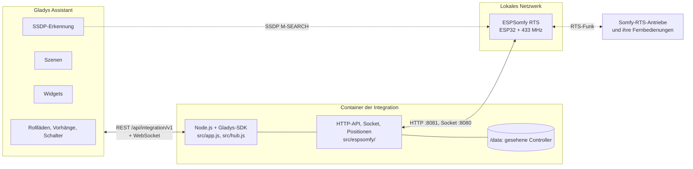
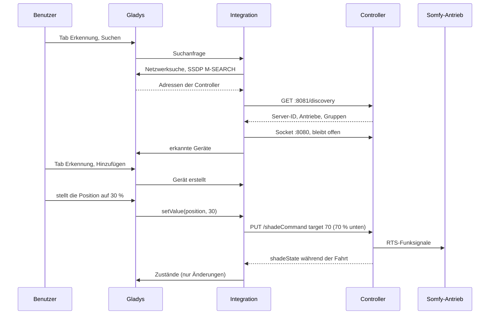

# ESPSomfy RTS für Gladys Assistant

[English](README.md) | [Français](README.fr.md) | **Deutsch** | [Español](README.es.md)

[](LICENSE)
[](https://github.com/William-De71/gladys-espsomfy-rts/releases)
[](https://github.com/William-De71/gladys-espsomfy-rts/actions/workflows/release.yml)
[](https://gladysassistant.com)


Ihre Somfy-RTS-Rollläden, Jalousien, Markisen, Vorhänge, Garagentore und Tore in Gladys Assistant, über einen [ESPSomfy-RTS](https://github.com/rstrouse/ESPSomfy-RTS)-Controller (ein ESP32 mit 433-MHz-Funkmodul), in Ihrem lokalen Netzwerk, jede Bewegung in Echtzeit gemeldet. Positionen, die „My“-Lieblingsposition, Sonnen- und Windsensoren, Tastendrücke Ihrer Somfy-Fernbedienungen als Szenenauslöser, zwei Widgets. Inoffiziell, nicht mit Somfy verbunden.

## Funktionen

- **Erkennung** über die SSDP-Suche von Gladys; IP-Adressen können für Controller eingegeben werden, die sie nicht erreicht. Jeder Controller wird über seine Server-ID (Ende seiner MAC-Adresse) erkannt und nach einer Adressänderung wiedergefunden.
- **Ein Gerät pro Antrieb und pro Gruppe**: Rollläden (öffnen / stoppen / schließen, Position), Vorhänge, Lamellen als zweite Position, Garagentore und Tore mit einer Taste, potentialfreie Kontakte als Schalter und der Schalter „Sonnensensor aktiv“ der Antriebe mit Somfy-Sonnensensor.
- **Gemeldete Zustände**: Der Controller meldet jede Bewegung über seinen lokalen Socket, ob von Gladys, einer Fernbedienung oder seiner Webseite; nichts wird abgefragt.
- **Zwei Dashboard-Widgets**: ein Antrieb oder eine Gruppe mit Live-Anzeige, „My“-Position, Sonne und Wind und den Tasten Öffnen, My, Schließen; alle Antriebe auf einen Blick mit den Controllern und ihren Firmware-Updates.
- **Vier Szenenauslöser** (eine Somfy-Fernbedienung wird gedrückt, Sonne oder Wind ändert sich, ein Controller ist weg, ein Controller ist zurück) und **zwei Szenenaktionen** (einen Somfy-Befehl wie „My“ senden, die Position eines Antriebs korrigieren).
- Alles bleibt im lokalen Netzwerk: kein Konto, keine Cloud, kein Geheimnis.
- Englisch, Französisch, Deutsch und Spanisch.

## Funktionsweise




Gladys sendet im Netzwerk des Hosts ein SSDP-M-SEARCH `ssdp:all` und leitet die Antworten weiter, von denen die Integration die von ESPSomfy RTS behält (`SERVER: … ESPSomfyRTS/2.0`, Gerätetyp `urn:schemas-rstrouse-org:device:ESPSomfyRTS:1`); eine Suche nur nach diesem Gerätetyp würde an die Multicast-Gruppe beantwortet, die der Kern nicht abhört: Der Container sitzt hinter der Docker-Bridge, wo Multicast das Netzwerk nie erreicht. Die Firmware kündigt auch den mDNS-Dienst `_espsomfy_rts._tcp` an, aber dessen Unterstrich lehnen der Store und der Gladys-Kern ab (RFC 6763), daher SSDP. Die Integration liest dann `GET /discovery` über die HTTP-API des Controllers (Port 8081: Server-ID, Antriebe, Gruppen, Räume, Firmware) und hält seinen Socket offen (Port 8080, ein socket.io-ähnliches Textprotokoll: `42[shadeState,{…}]`). Befehle sind `PUT /shadeCommand`, `/groupCommand`, `/tiltCommand` und `/setPositions`; der Controller sendet die Funksignale und meldet die Bewegungen.




### Geräte und Funktionen

| Antriebstyp (Firmware)                                                     | Gladys-Gerät | Funktionen                                              |
| -------------------------------------------------------------------------- | ------------ | ------------------------------------------------------- |
| Rollladen, Klappladen, Jalousie, Markise, Garagentor und Tore mit 3 Tasten | `shutter`    | `state` (−1 schließen, 0 stoppen, 1 öffnen), `position` |
| Vorhang (links, rechts, Mitte)                                             | `curtain`    | `state`, `position`                                     |
| Jalousie mit Wendemotor (tilt motor, integrated, euro)                     | `shutter`    | `state`, `position`, `tilt`                             |
| reine Lamellen-Jalousie                                                    | `shutter`    | `state`, `position` (die Lamellen)                      |
| Garagentor und Tore mit 1 Taste                                            | `shutter`    | nur `state`                                             |
| potentialfreier Kontakt                                                    | `switch`     | `contact` (`binary`)                                    |
| Antrieb mit Sonnensensor, Markise                                          | + `switch`   | `sun-flag` (`binary`)                                   |
| Gruppe                                                                     | `shutter`    | `state` (+ `sun-flag`)                                  |

Positionen reichen von 0 % zu bis 100 % offen, wie Gladys zählt; die Firmware zählt, wie weit abgesenkt (eine Markise: wie weit ausgefahren), mit optionalem „flip position“. Die Umrechnungen sind die der [Home-Assistant-Integration](https://github.com/rstrouse/ESPSomfy-RTS-HA) des Firmware-Autors. Externe IDs: `ext:<selector>:shade:<Server-ID>-<Antriebs-ID>` und `ext:<selector>:group:<Server-ID>-<Gruppen-ID>`; Funktionen `…:state`, `…:position`, `…:tilt`, `…:contact`, `…:sun-flag`.

## Transport

`transports: ["local"]`: Der Katalog zeigt das Abzeichen **lokal**. Nichts verlässt das lokale Netzwerk. Jedes Gerät meldet **lokal**, solange sein Controller antwortet, sonst **nicht erreichbar**; es gibt weder eine lokale Präferenz noch einen eingeschränkten Modus.

## Widgets


- **Somfy-Antrieb** (`shade`, Einstellung: ein Antrieb oder eine Gruppe): Live-Anzeige der Position, Zustand, „My“-Position, Lamellen, Sonne, Wind, Sonnensensor und die Tasten **Öffnen**, **My** (die im Motor gespeicherte Lieblingsposition), **Schließen** und der Sonnensensor. Ein Relais zeigt **Einschalten / Ausschalten**, ein Tor mit einer Taste eine einzige Taste.
- **Somfy-Antriebe** (`overview`): alle zu Gladys hinzugefügten Antriebe (höchstens acht) mit Zustand und Position, die Controller mit ihrer Verbindung und dem Firmware-Update, wenn eines erscheint.

## Szenenauslöser und -aktionen

Auslöser:

- `remote_pressed` — **Eine Somfy-Fernbedienung wird gedrückt**: eine mit einem Antrieb gekoppelte Fernbedienung, ein Wandsender oder eine Situo, vom Controller gehört. Filter: Antrieb, Taste (`up`, `down`, `my`, `my_up`, `my_down`, `up_down`, `my_up_down`, `prog`, `step_up`, `step_down`, `toggle`, `favorite`, `stop`). Variablen: `device_name`, `button`, `remote_address`. Ein Ereignis pro Tastendruck; die Signale, die der Controller selbst sendet (Gladys, Szenen, Gruppen), lösen ihn nie aus.
- `sun_wind_changed` — **Sonne oder Wind ändert sich** (Somfy-Sonnen- und Windsensor eines Antriebs). Filter: Antrieb, `sensor` (`sun`, `wind`), `state` (`on`, `off`). Variable: `device_name`.
- `controller_offline` — **Ein ESPSomfy-RTS-Controller ist weg** (seit einer Minute keine Antwort). Variablen: `controller_name`, `address`.
- `controller_online` — **Ein ESPSomfy-RTS-Controller ist zurück** (nach einem „weg“-Ereignis).

Aktionen:

- `send_command` — **Somfy-Befehl senden** an einen Antrieb oder eine Gruppe: `my` (Lieblingsposition; stoppt einen fahrenden Antrieb), `open`, `close`, `step_open`, `step_close`, `sun_flag_on`, `sun_flag_off`.
- `set_current_position` — **Position eines Antriebs korrigieren**, ohne ihn zu bewegen: `position` (% offen), optional `tilt`.

Beispiele:

- **Eine Somfy-Fernbedienung wird gedrückt**, Wohnzimmer, Taste `my` → Licht dimmen und Fernseher einschalten.
- **Sonne oder Wind ändert sich**, Terrassenmarkise, `wind`, `on` → eine Benachrichtigung senden.
- Bei Sonnenuntergang → **Somfy-Befehl senden** `my` an die Gruppe Erdgeschoss.

## Voraussetzungen

- Gladys Assistant **5.3.0 oder neuer** (Katalog-Suchbegriffe und Länder von Gladys 5.3, Dashboard-Widgets sowie Szenenauslöser und -aktionen von Integrationen; ältere Instanzen können die Integration nicht installieren).
- Ein ESPSomfy-RTS-Controller, Firmware **2.4** oder neuer (getestet nach dem Protokoll von 2.4.7, der neuesten Version), im selben Netzwerk wie Gladys, mit auf seiner Webseite angelegten und gekoppelten Antrieben und Gruppen.

## Installation

- **Aus dem Store**: Integrationen → „ESPSomfy RTS“ suchen → Installieren. Akzeptieren Sie die Netzwerkerkennung (SSDP) auf dem Installationsbildschirm.
- **Über die URL des Repositorys**: Integrationen → Eine Integration installieren → `https://github.com/William-De71/gladys-espsomfy-rts` einfügen.
- **Entwicklermodus**: Integrationen → Eine Integration installieren → Entwicklermodus, mit dem Manifest eines Builds (die Zusammenfassung des Workflows „Build and publish image“ zeigt es).

## Konfiguration

| Feld              | Typ    | Standard | Bedeutung                                                                      |
| ----------------- | ------ | -------- | ------------------------------------------------------------------------------ |
| `hosts`           | string | leer     | IP-Adressen von Controllern, die die Suche nicht findet, durch Kommas getrennt |
| `rescan_interval` | select | `60`     | automatische Suche in Minuten: `0` (aus), `15`, `60`                           |
| `language`        | select | `en`     | Sprache der Funktionsnamen und der Szenenfehler                                |

Taste der Konfigurationsseite: **Controller suchen** (durchsucht das Netzwerk und die Adressen, listet jeden Controller mit Adresse, Firmware, Antrieben und Gruppen auf).

## Verwendung

1. Installieren Sie die Integration und klicken Sie dann auf **Controller suchen**.
2. Fügen Sie die Antriebe und Gruppen im Tab **Erkennung** hinzu.
3. Ordnen Sie sie Räumen zu, fügen Sie die Widgets einem Dashboard hinzu, erstellen Sie Ihre Szenen.

Die Benutzerdokumentation finden Sie in [docs/de.md](docs/de.md) ([en](docs/en.md), [fr](docs/fr.md), [es](docs/es.md)).

## Grenzen

- **Nie mit einem echten Controller getestet**: Alles wird gegen einen simulierten Controller (echter lokaler HTTP-Server und Socket) getestet, der dem Quellcode der Firmware 2.4.7 folgt. Rückmeldungen sind willkommen.
- Die Positionen sind die des Controllers: geschätzt anhand der auf seiner Webseite eingestellten Laufzeiten und der gehörten Funksignale. Eine Fernbedienung, die er nicht hört, bewegt einen Antrieb, ohne es ihm zu sagen (nutzen Sie **Position eines Antriebs korrigieren**).
- Kein Koppeln, kein Anlegen von Antrieben, kein Firmware-Update, keine Sicherung aus Gladys: Nutzen Sie die Webseite des Controllers.
- Eine Gruppe hat weder Position noch Rückmeldung; das Licht mancher Antriebe und die Sonnen-/Windsimulation werden nicht angeboten.
- Die HTTP-API der Firmware hat keine Authentifizierung (eine PIN schützt nur ihre Webseite).

## Lokale Entwicklung

```bash
npm install
GLADYS_HOST_API_URL=http://localhost:1443 \
  GLADYS_INTEGRATION_TOKEN=… GLADYS_INTEGRATION_SELECTOR=… \
  ESPSOMFY_DATA_DIR=./data DEBUG=gladys-integration-sdk node index.js
```

| Variable                                                                         | Standard           | Verwendung                                |
| -------------------------------------------------------------------------------- | ------------------ | ----------------------------------------- |
| `GLADYS_HOST_API_URL`, `GLADYS_INTEGRATION_TOKEN`, `GLADYS_INTEGRATION_SELECTOR` | von Gladys gesetzt | Verbindung zur Host-API von Gladys        |
| `ESPSOMFY_DATA_DIR`                                                              | `/data`            | Ordner von `controllers.json`             |
| `DEBUG`                                                                          | nicht gesetzt      | `gladys-integration-sdk` für die SDK-Logs |

| Skript                            | Was es tut                               |
| --------------------------------- | ---------------------------------------- |
| `npm test`                        | die Tests (`node --test`), ohne Netzwerk |
| `npm run lint`                    | ESLint                                   |
| `npm run format` / `format:check` | Prettier                                 |
| `docs/illustrations/render.sh`    | erzeugt die Widget-Illustrationen neu    |
| `scripts/build-cover.sh`          | erzeugt `cover.jpg` aus `cover.svg` neu  |

## Tests

`npm test` lässt die ganze Integration gegen das Fake-Gladys des SDK und simulierte ESPSomfy-RTS-Controller auf echten lokalen HTTP-Servern und Sockets laufen, die der Firmware folgen: nach unten gezählte Positionen, „flip position“, „My“, das zur Lieblingsposition fährt oder stoppt, Tore mit einer Taste, potentialfreie Kontakte, Gruppen, Tastendrücke von Fernbedienungen (`source: "remote"`) und eigene Signale des Controllers (`internal`), Sonnen- und Windflags, auf der Webseite hinzugefügte Antriebe. Abgedeckt: Erkennung per SSDP und per Adresse, gemeldete Zustände, jeder Befehl, Szenenauslöser und -aktionen, beide Widgets geprüft mit `validateWidgetContent`, verlorene und zurückkehrende Controller, Neustarts. Die Geräte werden gegen die Regeln des Gladys-Kerns und eine Erkennungsreferenz geprüft (externe IDs sind dauerhaft), das Manifest gegen den Code, die Übersetzungen und das Release-Skript. Die CI baut auch das Image und startet es wie Gladys (schreibgeschützt, 256 MB, ohne Netzwerk).

## Release-Prozess

Jeder Merge auf `main` veröffentlicht eine Version, wenn seine Commits es rechtfertigen, ohne manuellen Schritt:

```mermaid
flowchart LR
  A[Merge auf main] --> B[CI: Prettier, ESLint,<br/>Tests, Docker-Build]
  B --> C[nächste Version aus<br/>Conventional Commits]
  C --> D[Abschnitt in CHANGELOG.md]
  D --> E[Commit chore release<br/>+ Tag vX.Y.Z]
  E --> F[Image :X.Y.Z + :latest<br/>amd64 + arm64]
  F --> G[main rückt zum<br/>Release-Commit vor]
  G --> H[GitHub Release]
  H --> I[Prüfung: anonymer Pull,<br/>Store-Validator, Topic]
```




- `feat` → Minor, `fix` / `perf` → Patch, `!` oder `BREAKING CHANGE:` → Major (unter 1.0.0 ein Minor). `docs`, `chore`, `ci`, `test`, `style`, `refactor`, `build` allein veröffentlichen nichts.
- Der Titel des Pull Requests wird zum Squash-Commit, also zur Zeile im Changelog: Schreiben Sie ihn auf Englisch, für den Benutzer (`feat(widgets): …`). `pr-title.yml` prüft ihn. Bearbeiten Sie `CHANGELOG.md` nie von Hand.
- Das Image existiert, bevor `main` seine Version ankündigt (der Store indexiert `main`).
- 1.0.0 ist eine manuelle Entscheidung: Actions → Release → Run workflow, `release-as: 1.0.0`. `dry-run` zeigt Version und Changelog, ohne etwas zu veröffentlichen.
- **Geschütztes `main`**: Das Release pusht einen Commit auf `main`. Mit einem Branch-Schutz oder Ruleset, das Pull Requests oder Status-Checks verlangt, erlauben Sie GitHub Actions die Umgehung (oder nutzen Sie eine GitHub App), sonst stoppt das Release nach dem Image.
- Machen Sie das Paket nach dem ersten Release bei Bedarf öffentlich: Package settings → Change visibility → Public.

## Fehlerbehebung

- **Kein Controller gefunden**: Prüfen Sie, ob seine Webseite von einem Computer im selben Netzwerk antwortet und seine Option **SSDP broadcast** aktiv ist, oder geben Sie seine Adresse ein.
- **Ein Antrieb fehlt**: Legen Sie ihn auf der Webseite des Controllers an und suchen Sie dann erneut im Tab **Erkennung**.
- **Falsche Position**: Korrigieren Sie sie mit der Aktion **Position eines Antriebs korrigieren** oder verknüpfen Sie die Fernbedienung, die der Controller nicht hört.
- **„Gladys hat die Netzwerksuche abgelehnt“**: Installieren Sie die Integration neu und akzeptieren Sie die Netzwerkerkennung auf dem Installationsbildschirm.
- Logs: Tab Logs der Integration; `DEBUG=gladys-integration-sdk` für die SDK-Details.

## Mitwirken

Issues und Pull Requests sind willkommen. Führen Sie `npm run format:check`, `npm run lint` und `npm test` aus, schreiben Sie den Titel des Pull Requests als Conventional Commit und starten Sie `docs/illustrations/render.sh` nach jeder Änderung eines Widget-Inhalts. Eine neue Funktion darf die bestehenden nicht ändern (`test/fixtures/discovery.baseline.json`). Wenn sich ein echter Controller anders verhält, korrigieren Sie zuerst den simulierten Controller in `test/helpers/`, dann den Code.

## Sicherheit

Siehe [SECURITY.md](SECURITY.md). Die Integration hält kein Geheimnis; `/data/controllers.json` speichert Server-ID, Adresse und Hostnamen jedes gesehenen Controllers. Die HTTP-API eines ESPSomfy-RTS-Controllers hat keine Authentifizierung: Betreiben Sie ihn in einem vertrauenswürdigen Netzwerk, nie aus dem Internet erreichbar.

## Lizenz

[Apache License 2.0](LICENSE), siehe auch [NOTICE](NOTICE). Der Client wurde für dieses Projekt nach dem Quellcode von ESPSomfy RTS und seiner Home-Assistant-Integration geschrieben, beide von rstrouse und gemeinfrei. Somfy und RTS sind Marken von Somfy; dieses Projekt ist weder mit Somfy verbunden noch von Somfy genehmigt oder unterstützt.
