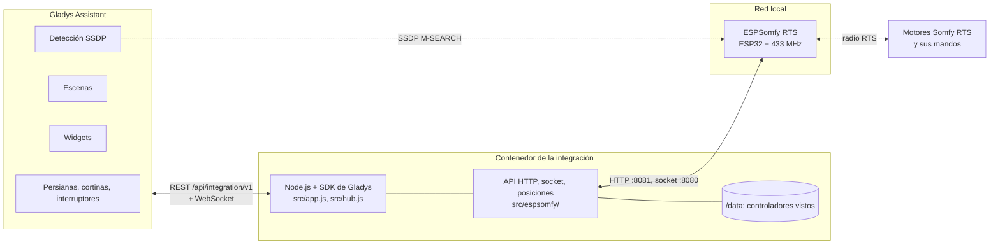
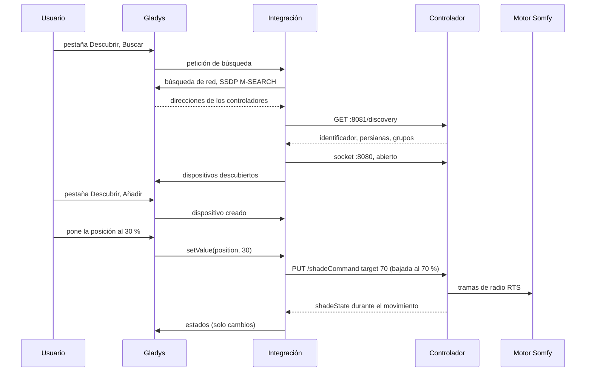

# ESPSomfy RTS para Gladys Assistant

[English](README.md) | [Français](README.fr.md) | [Deutsch](README.de.md) | **Español**

[](LICENSE)
[](https://github.com/William-De71/gladys-espsomfy-rts/releases)
[](https://github.com/William-De71/gladys-espsomfy-rts/actions/workflows/release.yml)
[](https://gladysassistant.com)


Sus persianas, estores, toldos, cortinas, puertas de garaje y portones Somfy RTS en Gladys Assistant, gracias a un controlador [ESPSomfy RTS](https://github.com/rstrouse/ESPSomfy-RTS) (un ESP32 con una radio de 433 MHz), en su red local, con cada movimiento comunicado en tiempo real. Posiciones, la posición favorita «My», sensores de sol y viento, las pulsaciones de sus mandos Somfy como disparadores de escena, dos widgets. No oficial, sin relación con Somfy.

## Funciones

- **Detección** mediante la búsqueda SSDP de Gladys; se pueden escribir direcciones IP para los controladores que no alcanza. Cada controlador se identifica por su identificador (final de su dirección MAC) y se vuelve a encontrar tras un cambio de dirección.
- **Un dispositivo por persiana y por grupo**: persianas (abrir / parar / cerrar, posición), cortinas, lamas como segunda posición, puertas de garaje y portones de un botón, contactos secos como interruptores, y el interruptor «sensor de sol activo» de los motores con sensor de sol Somfy.
- **Estados comunicados**: el controlador avisa de cada movimiento por su socket local, venga de Gladys, de un mando o de su página web; nada se consulta en bucle.
- **Dos widgets de panel**: una persiana o un grupo con un indicador en directo, su posición «My», el sol y el viento, y los botones Abrir, My, Cerrar; todas las persianas de un vistazo con los controladores y sus actualizaciones de firmware.
- **Cuatro disparadores de escena** (se pulsa un mando Somfy, cambia el sol o el viento, se pierde un controlador, vuelve un controlador) y **dos acciones de escena** (enviar una orden Somfy como «My», corregir la posición de una persiana).
- Todo se queda en la red local: sin cuenta, sin nube, sin secretos.
- Inglés, francés, alemán y español.

## Funcionamiento




Gladys, en la red del anfitrión, envía un M-SEARCH SSDP `ssdp:all` y retransmite las respuestas, de las que la integración se queda con las de ESPSomfy RTS (`SERVER: … ESPSomfyRTS/2.0`, tipo de dispositivo `urn:schemas-rstrouse-org:device:ESPSomfyRTS:1`); una búsqueda de ese único tipo de dispositivo se respondería al grupo multicast, que el núcleo no escucha: el contenedor está detrás del puente Docker, donde el multicast nunca llega a la red. El firmware también anuncia el servicio mDNS `_espsomfy_rts._tcp`, pero su guion bajo lo rechazan la tienda y el núcleo de Gladys (RFC 6763), de ahí SSDP. La integración lee después `GET /discovery` en la API HTTP del controlador (puerto 8081: identificador, persianas, grupos, estancias, firmware) y mantiene abierto su socket (puerto 8080, un protocolo de texto parecido a socket.io: `42[shadeState,{…}]`). Las órdenes son `PUT /shadeCommand`, `/groupCommand`, `/tiltCommand` y `/setPositions`; el controlador envía las tramas de radio y comunica los movimientos.




### Dispositivos y funciones

| Tipo de persiana (firmware)                                                      | Dispositivo Gladys | Funciones                                         |
| -------------------------------------------------------------------------------- | ------------------ | ------------------------------------------------- |
| persiana enrollable, contraventana, estor, toldo, garaje y portones de 3 botones | `shutter`          | `state` (−1 cerrar, 0 parar, 1 abrir), `position` |
| cortina (izquierda, derecha, centro)                                             | `curtain`          | `state`, `position`                               |
| estor con motor de inclinación (tilt motor, integrated, euro)                    | `shutter`          | `state`, `position`, `tilt`                       |
| estor solo de lamas                                                              | `shutter`          | `state`, `position` (las lamas)                   |
| garaje y portones de 1 botón                                                     | `shutter`          | solo `state`                                      |
| contacto seco                                                                    | `switch`           | `contact` (`binary`)                              |
| motor con sensor de sol, toldo                                                   | + `switch`         | `sun-flag` (`binary`)                             |
| grupo                                                                            | `shutter`          | `state` (+ `sun-flag`)                            |

Las posiciones van de 0 % cerrada a 100 % abierta, como las cuenta Gladys; el firmware cuenta cuánto ha bajado (un toldo: cuánto se ha desplegado), con un «flip position» opcional. Las conversiones son las de la [integración de Home Assistant](https://github.com/rstrouse/ESPSomfy-RTS-HA) del autor del firmware. Identificadores externos: `ext:<selector>:shade:<identificador>-<n.º de persiana>` y `ext:<selector>:group:<identificador>-<n.º de grupo>`; funciones `…:state`, `…:position`, `…:tilt`, `…:contact`, `…:sun-flag`.

## Transporte

`transports: ["local"]`: el catálogo muestra la insignia **local**. Nada sale de la red local. Cada dispositivo publica **local** mientras su controlador responde e **inaccesible** si no; no hay preferencia local que elegir ni modo degradado.

## Widgets


- **Persiana Somfy** (`shade`, ajuste: una persiana o un grupo): indicador en directo de la posición, estado, posición «My», lamas, sol, viento, sensor de sol, y los botones **Abrir**, **My** (la posición favorita guardada en el motor), **Cerrar** y el sensor de sol. Un relé muestra **Encender / Apagar**, un portón de un botón un solo botón.
- **Persianas Somfy** (`overview`): todas las persianas añadidas a Gladys (ocho como máximo) con su estado y su posición, los controladores con su conexión y la actualización de firmware cuando sale una.

## Disparadores y acciones de escena

Disparadores:

- `remote_pressed` — **Se pulsa un mando Somfy**: un mando, un pulsador de pared o un Situo emparejado con una persiana, oído por el controlador. Filtros: persiana, botón (`up`, `down`, `my`, `my_up`, `my_down`, `up_down`, `my_up_down`, `prog`, `step_up`, `step_down`, `toggle`, `favorite`, `stop`). Variables: `device_name`, `button`, `remote_address`. Un evento por pulsación; las tramas que envía el propio controlador (Gladys, escenas, grupos) nunca lo disparan.
- `sun_wind_changed` — **Cambia el sol o el viento** (sensor de sol y viento Somfy de un motor). Filtros: persiana, `sensor` (`sun`, `wind`), `state` (`on`, `off`). Variable: `device_name`.
- `controller_offline` — **Se pierde un controlador ESPSomfy RTS** (sin respuesta desde hace un minuto). Variables: `controller_name`, `address`.
- `controller_online` — **Vuelve un controlador ESPSomfy RTS** (tras un evento «perdido»).

Acciones:

- `send_command` — **Enviar una orden Somfy** a una persiana o un grupo: `my` (posición favorita; detiene una persiana en marcha), `open`, `close`, `step_open`, `step_close`, `sun_flag_on`, `sun_flag_off`.
- `set_current_position` — **Corregir la posición de una persiana** sin moverla: `position` (% abierta), `tilt` opcional.

Ejemplos:

- **Se pulsa un mando Somfy**, salón, botón `my` → bajar las luces y encender la tele.
- **Cambia el sol o el viento**, toldo de la terraza, `wind`, `on` → enviar una notificación.
- Al atardecer → **Enviar una orden Somfy** `my` al grupo de la planta baja.

## Requisitos

- Gladys Assistant **5.3.0 o posterior** (palabras clave y países del catálogo de Gladys 5.3, widgets de panel y disparadores y acciones de escena de las integraciones; las instancias más antiguas no pueden instalar la integración).
- Un controlador ESPSomfy RTS, firmware **2.4** o posterior (probado según el protocolo de la 2.4.7, la última versión), en la misma red que Gladys, con sus persianas y grupos creados y emparejados en su página web.

## Instalación

- **Desde la tienda**: Integraciones → buscar «ESPSomfy RTS» → Instalar. Acepte la detección de red (SSDP) en la pantalla de instalación.
- **Desde la URL del repositorio**: Integraciones → Instalar una integración → pegar `https://github.com/William-De71/gladys-espsomfy-rts`.
- **Modo desarrollador**: Integraciones → Instalar una integración → Modo desarrollador, con el manifiesto de un build (el resumen del workflow «Build and publish image» lo muestra).

## Configuración

| Campo             | Tipo   | Por defecto | Significado                                                                       |
| ----------------- | ------ | ----------- | --------------------------------------------------------------------------------- |
| `hosts`           | string | vacío       | direcciones IP de controladores que la búsqueda no encuentra, separadas por comas |
| `rescan_interval` | select | `60`        | búsqueda automática en minutos: `0` (desactivada), `15`, `60`                     |
| `language`        | select | `en`        | idioma de los nombres de las funciones y de los errores de escena                 |

Botón de la página de configuración: **Buscar los controladores** (busca en la red y en las direcciones, lista cada controlador con su dirección, su firmware, sus persianas y sus grupos).

## Uso

1. Instale la integración y pulse **Buscar los controladores**.
2. Añada las persianas y grupos desde la pestaña **Descubrir**.
3. Colóquelas en estancias, añada los widgets a un panel, cree sus escenas.

La documentación de usuario está en [docs/es.md](docs/es.md) ([en](docs/en.md), [fr](docs/fr.md), [de](docs/de.md)).

## Límites

- **Nunca probada con un controlador real**: todo se prueba contra un controlador simulado (servidor HTTP y socket locales reales) que sigue el código fuente del firmware 2.4.7. Se agradecen los comentarios.
- Las posiciones son las del controlador: estimadas a partir de los tiempos de recorrido ajustados en su página web y de las tramas que oye. Un mando que no oye mueve una persiana sin avisarle (use **Corregir la posición de una persiana**).
- Sin emparejamiento, sin creación de persianas, sin actualización de firmware ni copia de seguridad desde Gladys: use la página web del controlador.
- Un grupo no tiene posición ni confirmación de estado; la luz de algunos motores y la simulación de sol / viento no se ofrecen.
- La API HTTP del firmware no tiene autenticación (un PIN solo protege su página web).

## Desarrollo local

```bash
npm install
GLADYS_HOST_API_URL=http://localhost:1443 \
  GLADYS_INTEGRATION_TOKEN=… GLADYS_INTEGRATION_SELECTOR=… \
  ESPSOMFY_DATA_DIR=./data DEBUG=gladys-integration-sdk node index.js
```

| Variable                                                                         | Por defecto          | Uso                                            |
| -------------------------------------------------------------------------------- | -------------------- | ---------------------------------------------- |
| `GLADYS_HOST_API_URL`, `GLADYS_INTEGRATION_TOKEN`, `GLADYS_INTEGRATION_SELECTOR` | definidas por Gladys | conexión a la API del anfitrión de Gladys      |
| `ESPSOMFY_DATA_DIR`                                                              | `/data`              | carpeta de `controllers.json`                  |
| `DEBUG`                                                                          | sin definir          | `gladys-integration-sdk` para los logs del SDK |

| Script                            | Qué hace                                     |
| --------------------------------- | -------------------------------------------- |
| `npm test`                        | las pruebas (`node --test`), sin red         |
| `npm run lint`                    | ESLint                                       |
| `npm run format` / `format:check` | Prettier                                     |
| `docs/illustrations/render.sh`    | regenera las ilustraciones de los widgets    |
| `scripts/build-cover.sh`          | regenera `cover.jpg` a partir de `cover.svg` |

## Pruebas

`npm test` ejecuta toda la integración contra el Gladys simulado del SDK y controladores ESPSomfy RTS simulados en servidores HTTP y sockets locales reales, que siguen el firmware: posiciones contadas hacia abajo, «flip position», «My» que va a la posición favorita o detiene, portones de un botón, contactos secos, grupos, pulsaciones de mandos (`source: "remote"`) y tramas propias del controlador (`internal`), indicadores de sol y viento, persianas añadidas en la página web. Cubierto: detección por SSDP y por dirección, estados comunicados, cada orden, disparadores y acciones de escena, los dos widgets validados con `validateWidgetContent`, controladores perdidos y recuperados, reinicios. Los dispositivos se comprueban contra las reglas del núcleo de Gladys y una referencia de detección (los identificadores externos son eternos), el manifiesto contra el código, las traducciones y el script de release. La CI también construye la imagen y la arranca como Gladys (solo lectura, 256 MB, sin red).

## Proceso de release

Cada fusión en `main` publica una versión cuando sus commits lo justifican, sin paso manual:

```mermaid
flowchart LR
  A[fusión en main] --> B[CI: Prettier, ESLint,<br/>pruebas, build Docker]
  B --> C[versión siguiente según<br/>los Conventional Commits]
  C --> D[sección de CHANGELOG.md]
  D --> E[commit chore release<br/>+ tag vX.Y.Z]
  E --> F[imagen :X.Y.Z + :latest<br/>amd64 + arm64]
  F --> G[main avanza al<br/>commit de release]
  G --> H[GitHub Release]
  H --> I[verificación: pull anónimo,<br/>validador de la tienda, topic]
```




- `feat` → menor, `fix` / `perf` → parche, `!` o `BREAKING CHANGE:` → mayor (una menor por debajo de 1.0.0). `docs`, `chore`, `ci`, `test`, `style`, `refactor`, `build` solos no publican nada.
- El título de la pull request se convierte en el commit de squash, y por tanto en la línea del changelog: escríbalo en inglés, para el usuario (`feat(widgets): …`). `pr-title.yml` lo comprueba. No edite nunca `CHANGELOG.md` a mano.
- La imagen existe antes de que `main` anuncie su versión (la tienda indexa `main`).
- La 1.0.0 es una decisión manual: Actions → Release → Run workflow, `release-as: 1.0.0`. `dry-run` muestra la versión y el changelog sin publicar nada.
- **`main` protegida**: la release hace push de un commit a `main`. Con una protección de rama o un ruleset que exija pull requests o status checks, permita que GitHub Actions los omita (o use una GitHub App); si no, la release se detiene tras la imagen.
- Tras la primera release, haga público el paquete si hace falta: Package settings → Change visibility → Public.

## Solución de problemas

- **No se encuentra ningún controlador**: compruebe que su página web responde desde un ordenador de la misma red y que su opción **SSDP broadcast** está activa, o escriba su dirección.
- **Falta una persiana**: créela en la página web del controlador y vuelva a buscar en la pestaña **Descubrir**.
- **Posición incorrecta**: corríjala con la acción **Corregir la posición de una persiana**, o vincule el mando que el controlador no oye.
- **«Gladys rechazó la búsqueda en la red»**: reinstale la integración aceptando su detección de red en la pantalla de instalación.
- Registros: la pestaña Registros de la integración; `DEBUG=gladys-integration-sdk` para el detalle del SDK.

## Contribuir

Las issues y pull requests son bienvenidas. Ejecute `npm run format:check`, `npm run lint` y `npm test`, escriba el título de la pull request como Conventional Commit y vuelva a ejecutar `docs/illustrations/render.sh` tras cualquier cambio en el contenido de un widget. Una función nueva no debe cambiar las existentes (`test/fixtures/discovery.baseline.json`). Cuando un controlador real se comporta de otra forma, corrija primero el controlador simulado de `test/helpers/` y después el código.

## Seguridad

Vea [SECURITY.md](SECURITY.md). La integración no guarda ningún secreto; `/data/controllers.json` conserva el identificador, la dirección y el nombre de host de cada controlador visto. La API HTTP de un controlador ESPSomfy RTS no tiene autenticación: manténgalo en una red de confianza, nunca expuesto a Internet.

## Licencia

[Apache License 2.0](LICENSE), vea también [NOTICE](NOTICE). El cliente se escribió para este proyecto a partir del código fuente de ESPSomfy RTS y de su integración de Home Assistant, ambos de rstrouse y de dominio público. Somfy y RTS son marcas de Somfy; este proyecto no está afiliado a Somfy ni aprobado ni respaldado por Somfy.
