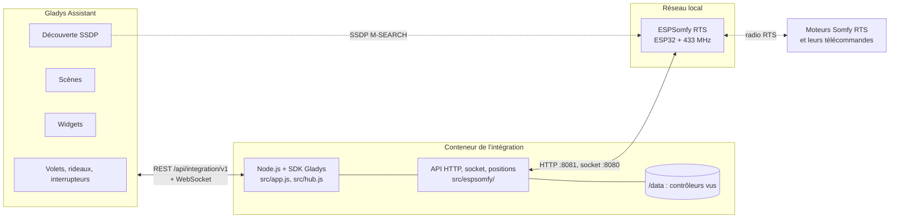
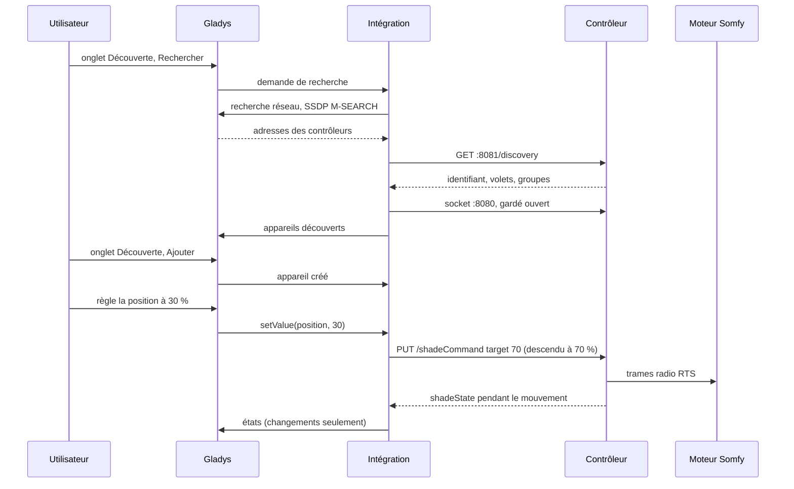

# ESPSomfy RTS pour Gladys Assistant

[English](README.md) | **Français** | [Deutsch](README.de.md) | [Español](README.es.md)

[](LICENSE)
[](https://github.com/William-De71/gladys-espsomfy-rts/releases)
[](https://github.com/William-De71/gladys-espsomfy-rts/actions/workflows/release.yml)
[](https://gladysassistant.com)


Vos volets roulants, stores, bannes, rideaux, portes de garage et portails Somfy RTS dans Gladys Assistant, grâce à un contrôleur [ESPSomfy RTS](https://github.com/rstrouse/ESPSomfy-RTS) (un ESP32 avec une radio 433 MHz), sur votre réseau local, chaque mouvement remonté en temps réel. Positions, position favorite « My », capteurs soleil et vent, appuis de vos télécommandes Somfy en déclencheurs de scène, deux widgets. Non officiel, sans lien avec Somfy.

## Fonctionnalités

- **Découverte** par la recherche SSDP de Gladys ; des adresses IP peuvent être saisies pour les contrôleurs qu’elle n’atteint pas. Chaque contrôleur est identifié par son identifiant (fin de son adresse MAC) et retrouvé après un changement d’adresse.
- **Un appareil par volet et par groupe** : volets (ouvrir / arrêter / fermer, position), rideaux, lames en seconde position, portes de garage et portails à un bouton, contacts secs en interrupteurs, et l’interrupteur « capteur soleil actif » des moteurs équipés d’un capteur soleil Somfy.
- **États remontés** : le contrôleur signale chaque mouvement sur son socket local, qu’il vienne de Gladys, d’une télécommande ou de sa page web ; rien n’est interrogé en boucle.
- **Deux widgets de tableau de bord** : un volet ou un groupe avec une jauge en direct, sa position « My », le soleil et le vent, et les boutons Ouvrir, My, Fermer ; tous les volets d’un coup d’œil avec les contrôleurs et leurs mises à jour du micrologiciel.
- **Quatre déclencheurs de scène** (une télécommande Somfy est pressée, le soleil ou le vent change, un contrôleur est perdu, un contrôleur est de retour) et **deux actions de scène** (envoyer une commande Somfy comme « My », corriger la position d’un volet).
- Tout reste sur le réseau local : pas de compte, pas de cloud, aucun secret.
- Anglais, français, allemand et espagnol.

## Fonctionnement




Gladys, sur le réseau de l’hôte, envoie un M-SEARCH SSDP `ssdp:all` et relaie les réponses, dont l’intégration garde celles d’ESPSomfy RTS (`SERVER: … ESPSomfyRTS/2.0`, type d’appareil `urn:schemas-rstrouse-org:device:ESPSomfyRTS:1`) ; une recherche de ce seul type d’appareil recevrait sa réponse sur le groupe multicast, que le cœur n’écoute pas : le conteneur est derrière le pont Docker, où le multicast n’atteint jamais le réseau. Le micrologiciel annonce aussi le service mDNS `_espsomfy_rts._tcp`, mais son tiret bas est refusé par le store et par le cœur de Gladys (RFC 6763), d’où SSDP. L’intégration lit ensuite `GET /discovery` sur l’API HTTP du contrôleur (port 8081 : identifiant, volets, groupes, pièces, micrologiciel) et garde son socket ouvert (port 8080, un protocole texte proche de socket.io : `42[shadeState,{…}]`). Les commandes sont `PUT /shadeCommand`, `/groupCommand`, `/tiltCommand` et `/setPositions` ; le contrôleur envoie les trames radio et remonte les mouvements.




### Appareils et fonctionnalités

| Type de volet (micrologiciel)                                             | Appareil Gladys | Fonctionnalités                                      |
| ------------------------------------------------------------------------- | --------------- | ---------------------------------------------------- |
| volet roulant, volet, store vénitien, banne, garage et portails 3 boutons | `shutter`       | `state` (−1 fermer, 0 arrêter, 1 ouvrir), `position` |
| rideau (gauche, droite, centre)                                           | `curtain`       | `state`, `position`                                  |
| store avec moteur d’inclinaison (tilt motor, integrated, euro)            | `shutter`       | `state`, `position`, `tilt`                          |
| store à lames seules                                                      | `shutter`       | `state`, `position` (les lames)                      |
| garage et portails à 1 bouton                                             | `shutter`       | `state` seulement                                    |
| contact sec                                                               | `switch`        | `contact` (`binary`)                                 |
| moteur avec capteur soleil, banne                                         | + `switch`      | `sun-flag` (`binary`)                                |
| groupe                                                                    | `shutter`       | `state` (+ `sun-flag`)                               |

Les positions vont de 0 % fermé à 100 % ouvert, comme les compte Gladys ; le micrologiciel compte la descente (une banne : le déroulé), avec un « flip position » facultatif. Les conversions sont celles de l’[intégration Home Assistant](https://github.com/rstrouse/ESPSomfy-RTS-HA) de l’auteur du micrologiciel. Identifiants externes : `ext:<selector>:shade:<identifiant>-<n° de volet>` et `ext:<selector>:group:<identifiant>-<n° de groupe>` ; fonctionnalités `…:state`, `…:position`, `…:tilt`, `…:contact`, `…:sun-flag`.

## Transport

`transports: ["local"]` : le catalogue affiche le badge **local**. Rien ne sort du réseau local. Chaque appareil publie **local** tant que son contrôleur répond et **injoignable** sinon ; il n’y a ni préférence locale à choisir, ni mode dégradé.

## Widgets


- **Volet Somfy** (`shade`, réglage : un volet ou un groupe) : jauge en direct de la position, état, position « My », lames, soleil, vent, capteur soleil, et les boutons **Ouvrir**, **My** (la position favorite enregistrée dans le moteur), **Fermer** et le capteur soleil. Un relais affiche **Allumer / Éteindre**, un portail à un bouton un seul bouton.
- **Volets Somfy** (`overview`) : tous les volets ajoutés à Gladys (huit au plus) avec leur état et leur position, les contrôleurs avec leur connexion et la mise à jour du micrologiciel quand elle sort.

## Déclencheurs et actions de scène

Déclencheurs :

- `remote_pressed` — **Une télécommande Somfy est pressée** : une télécommande, un interrupteur mural ou une Situo appairés à un volet, entendus par le contrôleur. Filtres : volet, bouton (`up`, `down`, `my`, `my_up`, `my_down`, `up_down`, `my_up_down`, `prog`, `step_up`, `step_down`, `toggle`, `favorite`, `stop`). Variables : `device_name`, `button`, `remote_address`. Un événement par appui ; les trames que le contrôleur envoie lui-même (Gladys, scènes, groupes) ne le déclenchent jamais.
- `sun_wind_changed` — **Le soleil ou le vent change** (capteur soleil et vent Somfy d’un moteur). Filtres : volet, `sensor` (`sun`, `wind`), `state` (`on`, `off`). Variable : `device_name`.
- `controller_offline` — **Un contrôleur ESPSomfy RTS est perdu** (pas de réponse depuis une minute). Variables : `controller_name`, `address`.
- `controller_online` — **Un contrôleur ESPSomfy RTS est de retour** (après un événement « perdu »).

Actions :

- `send_command` — **Envoyer une commande Somfy** à un volet ou un groupe : `my` (position favorite ; arrête un volet en mouvement), `open`, `close`, `step_open`, `step_close`, `sun_flag_on`, `sun_flag_off`.
- `set_current_position` — **Corriger la position d’un volet** sans le bouger : `position` (% d’ouverture), `tilt` facultatif.

Exemples :

- **Une télécommande Somfy est pressée**, salon, bouton `my` → baisser les lumières et allumer la télé.
- **Le soleil ou le vent change**, store terrasse, `wind`, `on` → envoyer une notification.
- Au coucher du soleil → **Envoyer une commande Somfy** `my` au groupe du rez-de-chaussée.

## Prérequis

- Gladys Assistant **5.1.0 ou plus récent** (widgets de tableau de bord et déclencheurs et actions de scène des intégrations ; les instances plus anciennes ne peuvent pas installer l’intégration).
- Un contrôleur ESPSomfy RTS, micrologiciel **2.4** ou plus récent (testé selon le protocole de la 2.4.7, la dernière version), sur le même réseau que Gladys, avec ses volets et groupes créés et appairés dans sa page web.

## Installation

- **Depuis le store** : Intégrations → chercher « ESPSomfy RTS » → Installer. Acceptez la découverte réseau (SSDP) sur l’écran d’installation.
- **Depuis l’URL du dépôt** : Intégrations → Installer une intégration → coller `https://github.com/William-De71/gladys-espsomfy-rts`.
- **Mode développeur** : Intégrations → Installer une intégration → Mode développeur, avec le manifeste d’un build (le résumé du workflow « Build and publish image » l’affiche).

## Configuration

| Champ             | Type   | Défaut | Rôle                                                                                  |
| ----------------- | ------ | ------ | ------------------------------------------------------------------------------------- |
| `hosts`           | string | vide   | adresses IP des contrôleurs que la recherche ne trouve pas, séparées par des virgules |
| `rescan_interval` | select | `60`   | recherche automatique en minutes : `0` (désactivée), `15`, `60`                       |
| `language`        | select | `en`   | langue des noms de fonctionnalités et des erreurs de scène                            |

Bouton de la page de configuration : **Rechercher les contrôleurs** (cherche sur le réseau et aux adresses, liste chaque contrôleur avec son adresse, son micrologiciel, ses volets et ses groupes).

## Utilisation

1. Installez l’intégration, puis cliquez sur **Rechercher les contrôleurs**.
2. Ajoutez les volets et groupes depuis l’onglet **Découverte**.
3. Rangez-les dans les pièces, ajoutez les widgets à un tableau de bord, créez vos scènes.

La documentation utilisateur est dans [docs/fr.md](docs/fr.md) ([en](docs/en.md), [de](docs/de.md), [es](docs/es.md)).

## Limites

- **Jamais testée sur un vrai contrôleur** : tout est testé contre un contrôleur simulé (vrai serveur HTTP et socket locaux) qui suit le code source du micrologiciel 2.4.7. Les retours sont bienvenus.
- Les positions sont celles du contrôleur : estimées à partir des temps de course réglés dans sa page web et des trames qu’il entend. Une télécommande qu’il n’entend pas bouge un volet sans le lui dire (utilisez **Corriger la position d’un volet**).
- Pas d’appairage, pas de création de volet, pas de mise à jour du micrologiciel, pas de sauvegarde depuis Gladys : utilisez la page web du contrôleur.
- Un groupe n’a ni position ni retour d’état ; la lumière de certains moteurs et la simulation soleil / vent ne sont pas exposées.
- L’API HTTP du micrologiciel n’a pas d’authentification (un code PIN ne protège que sa page web).

## Développement local

```bash
npm install
GLADYS_HOST_API_URL=http://localhost:1443 \
  GLADYS_INTEGRATION_TOKEN=… GLADYS_INTEGRATION_SELECTOR=… \
  ESPSOMFY_DATA_DIR=./data DEBUG=gladys-integration-sdk node index.js
```

| Variable                                                                         | Défaut            | Usage                                         |
| -------------------------------------------------------------------------------- | ----------------- | --------------------------------------------- |
| `GLADYS_HOST_API_URL`, `GLADYS_INTEGRATION_TOKEN`, `GLADYS_INTEGRATION_SELECTOR` | fixées par Gladys | connexion à l’API hôte de Gladys              |
| `ESPSOMFY_DATA_DIR`                                                              | `/data`           | dossier de `controllers.json`                 |
| `DEBUG`                                                                          | non définie       | `gladys-integration-sdk` pour les logs du SDK |

| Script                            | Ce qu’il fait                                |
| --------------------------------- | -------------------------------------------- |
| `npm test`                        | les tests (`node --test`), sans réseau       |
| `npm run lint`                    | ESLint                                       |
| `npm run format` / `format:check` | Prettier                                     |
| `docs/illustrations/render.sh`    | régénère les illustrations des widgets       |
| `scripts/build-cover.sh`          | régénère `cover.jpg` à partir de `cover.svg` |

## Tests

`npm test` fait tourner toute l’intégration contre le faux Gladys du SDK et de faux contrôleurs ESPSomfy RTS sur de vrais serveurs HTTP et sockets locaux, qui suivent le micrologiciel : positions comptées vers le bas, « flip position », « My » qui va à la position favorite ou arrête, portails à un bouton, contacts secs, groupes, appuis de télécommande (`source: "remote"`) et trames propres du contrôleur (`internal`), drapeaux soleil et vent, volets ajoutés dans la page web. Couvert : découverte par SSDP et par adresse, états remontés, chaque commande, déclencheurs et actions de scène, les deux widgets validés par `validateWidgetContent`, contrôleurs perdus puis retrouvés, redémarrages. Les appareils sont vérifiés contre les règles du cœur de Gladys et une référence de découverte (les identifiants externes sont éternels), le manifeste contre le code, les traductions et le script de release. La CI construit aussi l’image et la démarre comme Gladys (lecture seule, 256 Mo, sans réseau).

## Processus de release

Chaque fusion sur `main` publie une version quand ses commits le justifient, sans étape manuelle :

```mermaid
flowchart LR
  A[fusion sur main] --> B[CI : Prettier, ESLint,<br/>tests, build Docker]
  B --> C[version suivante d’après<br/>les Conventional Commits]
  C --> D[section du CHANGELOG.md]
  D --> E[commit chore release<br/>+ tag vX.Y.Z]
  E --> F[image :X.Y.Z + :latest<br/>amd64 + arm64]
  F --> G[main avance au<br/>commit de release]
  G --> H[GitHub Release]
  H --> I[vérification : pull anonyme,<br/>validateur du store, topic]
```




- `feat` → mineure, `fix` / `perf` → correctif, `!` ou `BREAKING CHANGE:` → majeure (une mineure sous 1.0.0). `docs`, `chore`, `ci`, `test`, `style`, `refactor`, `build` seuls ne publient rien.
- Le titre de la pull request devient le commit de squash, donc la ligne du changelog : écrivez-le en anglais, pour l’utilisateur (`feat(widgets): …`). `pr-title.yml` le vérifie. N’éditez jamais `CHANGELOG.md` à la main.
- L’image existe avant que `main` annonce sa version (le store indexe `main`).
- La 1.0.0 est une décision manuelle : Actions → Release → Run workflow, `release-as: 1.0.0`. `dry-run` affiche la version et le changelog sans rien publier.
- **`main` protégée** : la release pousse un commit sur `main`. Avec une protection de branche ou un ruleset exigeant des pull requests ou des status checks, autorisez GitHub Actions à les contourner (ou utilisez une GitHub App), sinon la release s’arrête après l’image.
- Après la première release, rendez le package public si besoin : Package settings → Change visibility → Public.

## Dépannage

- **Aucun contrôleur trouvé** : vérifiez que sa page web répond depuis un ordinateur du même réseau, que son option **SSDP broadcast** est active, ou saisissez son adresse.
- **Un volet manque** : créez-le dans la page web du contrôleur, puis relancez une recherche dans l’onglet **Découverte**.
- **Position fausse** : corrigez-la avec l’action **Corriger la position d’un volet**, ou liez la télécommande que le contrôleur n’entend pas.
- **« Gladys a refusé la recherche réseau »** : réinstallez l’intégration en acceptant sa découverte réseau sur l’écran d’installation.
- Journaux : l’onglet Journaux de l’intégration ; `DEBUG=gladys-integration-sdk` pour le détail du SDK.

## Contribuer

Les issues et pull requests sont bienvenues. Lancez `npm run format:check`, `npm run lint` et `npm test`, écrivez le titre de la pull request en Conventional Commit, et relancez `docs/illustrations/render.sh` après toute modification d’un contenu de widget. Une nouvelle fonctionnalité ne doit pas changer les existantes (`test/fixtures/discovery.baseline.json`). Quand un vrai contrôleur se comporte autrement, corrigez d’abord le faux contrôleur de `test/helpers/`, puis le code.

## Sécurité

Voir [SECURITY.md](SECURITY.md). L’intégration ne détient aucun secret ; `/data/controllers.json` garde l’identifiant, l’adresse et le nom d’hôte de chaque contrôleur vu. L’API HTTP d’un contrôleur ESPSomfy RTS n’a pas d’authentification : gardez-le sur un réseau de confiance, jamais exposé à Internet.

## Licence

[Apache License 2.0](LICENSE), voir aussi [NOTICE](NOTICE). Le client a été écrit pour ce projet d’après le code source d’ESPSomfy RTS et de son intégration Home Assistant, tous deux de rstrouse et dans le domaine public. Somfy et RTS sont des marques de Somfy ; ce projet n’est ni affilié à Somfy, ni approuvé, ni soutenu par Somfy.
