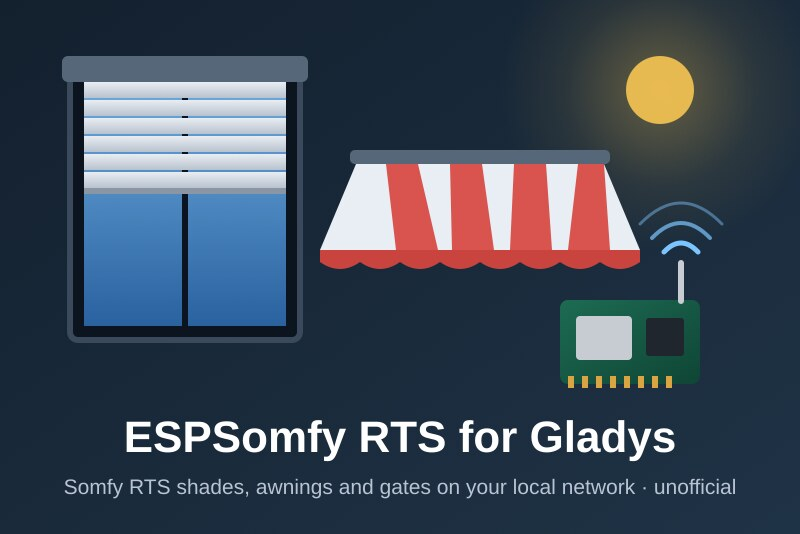
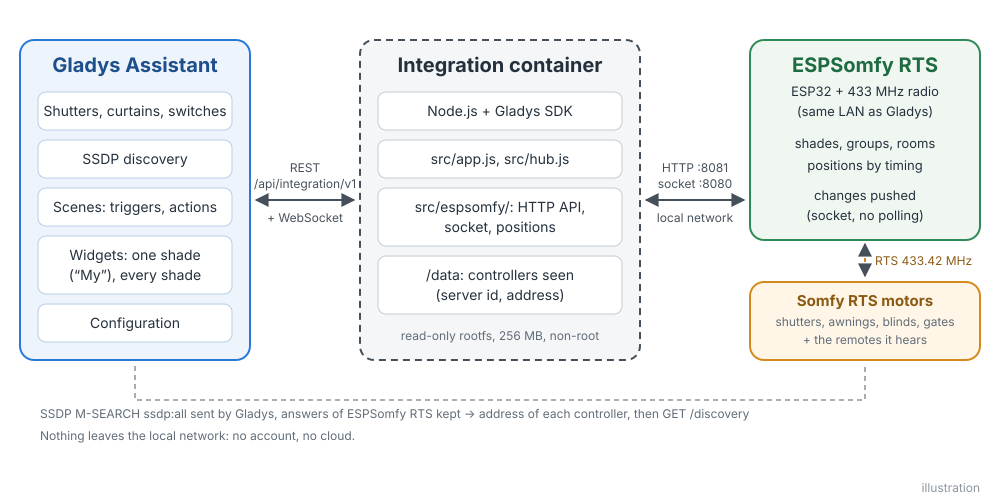
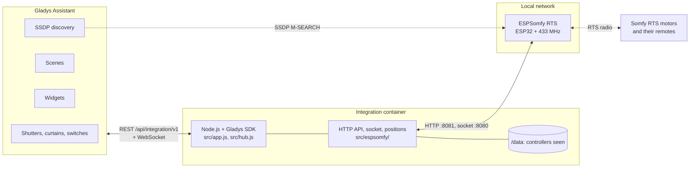
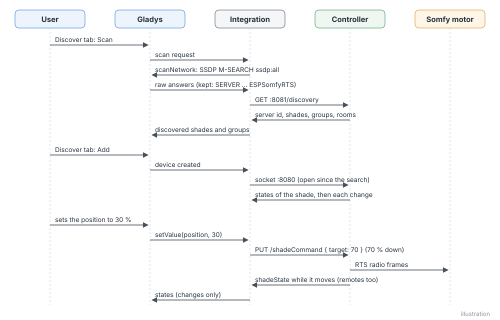
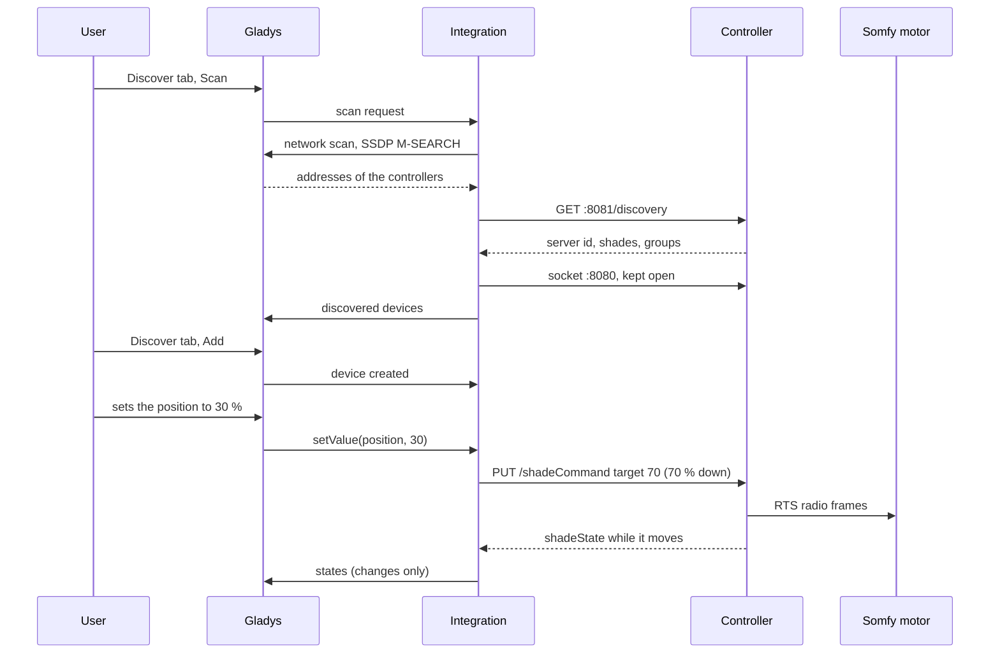
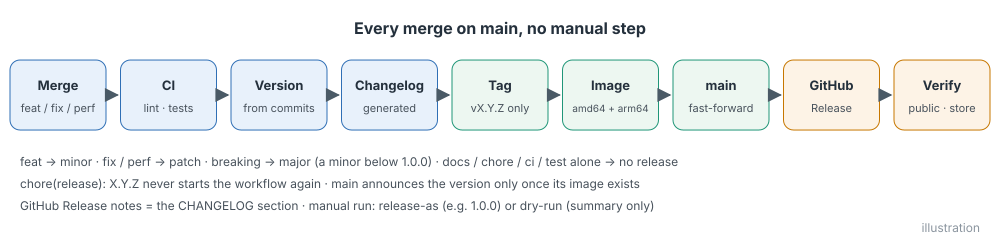

# ESPSomfy RTS for Gladys Assistant

**English** | [Français](README.fr.md) | [Deutsch](README.de.md) | [Español](README.es.md)

[](LICENSE)
[](https://github.com/William-De71/gladys-espsomfy-rts/releases)
[](https://github.com/William-De71/gladys-espsomfy-rts/actions/workflows/release.yml)
[](https://gladysassistant.com)



Your Somfy RTS roller shutters, blinds, awnings, curtains, garage doors and gates in Gladys Assistant, through an [ESPSomfy RTS](https://github.com/rstrouse/ESPSomfy-RTS) controller (an ESP32 with a 433 MHz radio), on your local network, with every move pushed in real time. Positions, the “My” favourite position, sun and wind sensors, the presses of your Somfy remotes as scene triggers, two widgets. Unofficial, not affiliated with Somfy.

## Features

- **Discovery** through the SSDP search of Gladys; IP addresses can be typed for the controllers it cannot reach. Each controller is identified by its server id (end of its MAC address) and found again after an address change.
- **One device per shade and per group**: shutters (open / stop / close, position), curtains, slats as a second position, one-button garage doors and gates, dry contacts as switches, and the “sun sensor active” switch of the motors with a Somfy sun sensor.
- **Pushed states**: the controller notifies every move over its local socket, from Gladys, a remote or its web page; nothing is polled.
- **Two dashboard widgets**: one shade or group with a live gauge, its “My” position, sun and wind, and the buttons Open, My, Close; every shade at a glance with the controllers and their firmware updates.
- **Four scene triggers** (a Somfy remote is pressed, sun or wind changes, a controller is lost, a controller is back) and **two scene actions** (send a Somfy command such as “My”, correct the position of a shade).
- Everything stays on the local network: no account, no cloud, no secret.
- English, French, German and Spanish.

## How it works





Gladys, on the host network, sends an SSDP M-SEARCH `ssdp:all` and relays the answers, of which the integration keeps those of ESPSomfy RTS (`SERVER: … ESPSomfyRTS/2.0`, device type `urn:schemas-rstrouse-org:device:ESPSomfyRTS:1`); a search for that device type alone would be answered to the multicast group, which the core does not listen to: the container sits behind the Docker bridge, where multicast never reaches the network. The firmware also announces the mDNS service `_espsomfy_rts._tcp`, but its underscore is refused by the store and by the Gladys core (RFC 6763), hence SSDP. The integration then reads `GET /discovery` on the HTTP API of the controller (port 8081: server id, shades, groups, rooms, firmware) and keeps its socket open (port 8080, a socket.io-like text protocol: `42[shadeState,{…}]`). Commands are `PUT /shadeCommand`, `/groupCommand`, `/tiltCommand` and `/setPositions`; the controller sends the radio frames and pushes the moves.





### Devices and features

| Shade type (firmware)                                                | Gladys device | Features                                       |
| -------------------------------------------------------------------- | ------------- | ---------------------------------------------- |
| roller shade, shutter, blind, awning, 3-button garage door and gates | `shutter`     | `state` (−1 close, 0 stop, 1 open), `position` |
| drapery (left, right, centre)                                        | `curtain`     | `state`, `position`                            |
| blind with a tilt motor (tilt motor, integrated, euro)               | `shutter`     | `state`, `position`, `tilt`                    |
| tilt-only blind                                                      | `shutter`     | `state`, `position` (the slats)                |
| 1-button garage door and gates                                       | `shutter`     | `state` only                                   |
| dry contact                                                          | `switch`      | `contact` (`binary`)                           |
| motor with a sun sensor, awning                                      | + `switch`    | `sun-flag` (`binary`)                          |
| group                                                                | `shutter`     | `state` (+ `sun-flag`)                         |

Positions are 0 % closed to 100 % open, as Gladys counts them; the firmware counts how far down (an awning: how far out), with an optional “flip position”. The conversions are those of the [Home Assistant integration](https://github.com/rstrouse/ESPSomfy-RTS-HA) of the firmware author. External ids: `ext:<selector>:shade:<server id>-<shade id>` and `ext:<selector>:group:<server id>-<group id>`; features `…:state`, `…:position`, `…:tilt`, `…:contact`, `…:sun-flag`.

## Transport

`transports: ["local"]`: the catalogue shows the **local** badge. Nothing leaves the local network. Each device publishes **local** while its controller answers and **unreachable** otherwise; there is no local preference to choose, nor degraded mode.

## Widgets


- **Somfy shade** (`shade`, setting: one shade or group): live gauge of the position, state, “My” position, slats, sun, wind, sun sensor, and the buttons **Open**, **My** (the favourite position stored in the motor), **Close** and the sun sensor. A relay shows **Turn on / off**, a one-button gate a single button.
- **Somfy shades** (`overview`): every shade added to Gladys (eight at most) with its state and position, the controllers with their connection and the firmware update when one is out.

## Scene triggers and actions

Triggers:

- `remote_pressed` — **A Somfy remote is pressed**: a remote, wall switch or Situo paired with a shade, heard by the controller. Filters: shade, button (`up`, `down`, `my`, `my_up`, `my_down`, `up_down`, `my_up_down`, `prog`, `step_up`, `step_down`, `toggle`, `favorite`, `stop`). Variables: `device_name`, `button`, `remote_address`. One event per press; the frames the controller sends itself (Gladys, scenes, groups) never trigger it.
- `sun_wind_changed` — **Sun or wind changes** (Somfy sun and wind sensor of a motor). Filters: shade, `sensor` (`sun`, `wind`), `state` (`on`, `off`). Variable: `device_name`.
- `controller_offline` — **An ESPSomfy RTS controller is lost** (no answer for a minute). Variables: `controller_name`, `address`.
- `controller_online` — **An ESPSomfy RTS controller is back** (after an offline event).

Actions:

- `send_command` — **Send a Somfy command** to a shade or a group: `my` (favourite position; stops a moving shade), `open`, `close`, `step_open`, `step_close`, `sun_flag_on`, `sun_flag_off`.
- `set_current_position` — **Correct the position of a shade** without moving it: `position` (% open), optional `tilt`.

Examples:

- **A Somfy remote is pressed**, living room, button `my` → dim the lights and turn on the TV.
- **Sun or wind changes**, terrace awning, `wind`, `on` → send a notification.
- At sunset → **Send a Somfy command** `my` to the ground-floor group.

## Requirements

- Gladys Assistant **5.1.0 or later** (dashboard widgets and scene triggers and actions of integrations; older instances cannot install the integration).
- An ESPSomfy RTS controller, firmware **2.4** or later (tested against the protocol of 2.4.7, the latest release), on the same network as Gladys, with its shades and groups created and paired in its web page.

## Installation

- **From the store**: Integrations → search "ESPSomfy RTS" → Install. Accept the network discovery (SSDP) on the install screen.
- **From the repository URL**: Integrations → Install an integration → paste `https://github.com/William-De71/gladys-espsomfy-rts`.
- **Developer mode**: Integrations → Install an integration → Developer mode, with the manifest of a build (the summary of the "Build and publish image" workflow prints it).

## Configuration

| Field             | Type   | Default | Meaning                                                                   |
| ----------------- | ------ | ------- | ------------------------------------------------------------------------- |
| `hosts`           | string | empty   | IP addresses of controllers the search does not find, separated by commas |
| `rescan_interval` | select | `60`    | automatic search in minutes: `0` (off), `15`, `60`                        |
| `language`        | select | `en`    | language of the feature names and of the scene errors                     |

Button of the configuration page: **Search the controllers** (searches the network and the addresses, lists every controller with its address, firmware, shades and groups).

## Usage

1. Install the integration, then press **Search the controllers**.
2. Add the shades and groups from the **Discover** tab.
3. Put them in rooms, add the widgets to a dashboard, create your scenes.

The user documentation is in [docs/en.md](docs/en.md) ([fr](docs/fr.md), [de](docs/de.md), [es](docs/es.md)).

## Limits

- **Never tested on a real controller**: everything is tested against a simulated controller (real local HTTP server and socket) that follows the source code of firmware 2.4.7. Feedback welcome.
- The positions are those of the controller: estimated from the travel times set in its web page and the frames it hears. A remote it does not hear moves a shade without telling it (use **Correct the position of a shade**).
- No pairing, no shade creation, no firmware update, no backup from Gladys: use the web page of the controller.
- A group has no position nor feedback; the light of some motors and the sun / wind simulation are not exposed.
- The HTTP API of the firmware has no authentication (a PIN only protects its web page).

## Local development

```bash
npm install
GLADYS_HOST_API_URL=http://localhost:1443 \
  GLADYS_INTEGRATION_TOKEN=… GLADYS_INTEGRATION_SELECTOR=… \
  ESPSOMFY_DATA_DIR=./data DEBUG=gladys-integration-sdk node index.js
```

| Variable                                                                         | Default       | Use                                       |
| -------------------------------------------------------------------------------- | ------------- | ----------------------------------------- |
| `GLADYS_HOST_API_URL`, `GLADYS_INTEGRATION_TOKEN`, `GLADYS_INTEGRATION_SELECTOR` | set by Gladys | connection to the Gladys host API         |
| `ESPSOMFY_DATA_DIR`                                                              | `/data`       | folder of `controllers.json`              |
| `DEBUG`                                                                          | unset         | `gladys-integration-sdk` for the SDK logs |

| Script                            | What it does                            |
| --------------------------------- | --------------------------------------- |
| `npm test`                        | the tests (`node --test`), no network   |
| `npm run lint`                    | ESLint                                  |
| `npm run format` / `format:check` | Prettier                                |
| `docs/illustrations/render.sh`    | regenerate the widget illustrations     |
| `scripts/build-cover.sh`          | regenerate `cover.jpg` from `cover.svg` |

## Tests

`npm test` runs the whole integration against the fake Gladys of the SDK and fake ESPSomfy RTS controllers on real local HTTP servers and sockets, which follow the firmware: positions counted downwards, “flip position”, “My” going to the favourite position or stopping, one-button gates, dry contacts, groups, remote presses (`source: "remote"`) and the controller's own frames (`internal`), sun and wind flags, shades added in the web page. Covered: discovery by SSDP and by address, pushed states, every command, scene triggers and actions, both widgets validated by `validateWidgetContent`, lost and returning controllers, restarts. The devices are checked against the rules of the Gladys core and a discovery baseline (external ids are forever), the manifest against the code, the translations and the release script. The CI also builds the image and starts it like Gladys does (read-only, 256 MB, no network).

## Release process

Every merge on `main` publishes a release when its commits deserve one, with no manual step:

```mermaid
flowchart LR
  A[merge on main] --> B[CI: Prettier, ESLint,<br/>tests, Docker build]
  B --> C[next version from<br/>Conventional Commits]
  C --> D[CHANGELOG.md section]
  D --> E[commit chore release<br/>+ tag vX.Y.Z]
  E --> F[image :X.Y.Z + :latest<br/>amd64 + arm64]
  F --> G[main moves to<br/>the release commit]
  G --> H[GitHub Release]
  H --> I[verify: anonymous pull,<br/>store validator, topic]
```





- `feat` → minor, `fix` / `perf` → patch, `!` or `BREAKING CHANGE:` → major (a minor below 1.0.0). `docs`, `chore`, `ci`, `test`, `style`, `refactor`, `build` alone publish nothing.
- The pull request title becomes the squash commit, hence the changelog line: write it in English, for the user (`feat(widgets): …`). `pr-title.yml` checks it. Never edit `CHANGELOG.md` by hand.
- The image exists before `main` announces its version (the store indexes `main`).
- 1.0.0 is a manual decision: Actions → Release → Run workflow, `release-as: 1.0.0`. `dry-run` shows the version and the changelog without publishing.
- **Protected `main`**: the release pushes a commit to `main`. With a branch protection or a ruleset requiring pull requests or status checks, allow GitHub Actions to bypass it (or use a GitHub App), otherwise the release stops after the image.
- After the first release, make the package public if needed: Package settings → Change visibility → Public.

## Troubleshooting

- **No controller found**: check that its web page answers from a computer of the same network, that its **SSDP broadcast** option is on, or type its address.
- **A shade is missing**: create it in the web page of the controller, then search again in the **Discover** tab.
- **Wrong position**: correct it with the **Correct the position of a shade** action, or link the remote the controller does not hear.
- **"Gladys refused the network search"**: reinstall the integration and accept its network discovery on the install screen.
- Logs: the Logs tab of the integration; `DEBUG=gladys-integration-sdk` for the SDK details.

## Contributing

Issues and pull requests are welcome. Run `npm run format:check`, `npm run lint` and `npm test`, write the pull request title as a Conventional Commit, and run `docs/illustrations/render.sh` after any change to a widget content. A new feature must not change the existing ones (`test/fixtures/discovery.baseline.json`). When a real controller behaves differently, fix the fake controller of `test/helpers/` first, then the code.

## Security

See [SECURITY.md](SECURITY.md). The integration holds no secret; `/data/controllers.json` keeps the server id, address and host name of each controller seen. The HTTP API of an ESPSomfy RTS controller has no authentication: keep it on a trusted network, never exposed to the Internet.

## License

[Apache License 2.0](LICENSE), see also [NOTICE](NOTICE). The client was written for this project from the source code of ESPSomfy RTS and of its Home Assistant integration, both by rstrouse and in the public domain. Somfy and RTS are trademarks of Somfy; this project is not affiliated with, endorsed or supported by Somfy.
